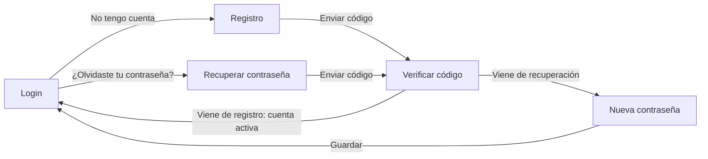

# Diseño de Interfaces Web

## UD2 – Actividad 4: Login y registro

Diseña con **Figma** e implementa (**opcional**) mediante **HTML + CSS + JavaScript** un sistema completo de autenticación de usuarios para una aplicación web, incluyendo las vistas de **login**, **registro**, **recuperación de contraseña** y **verificación de identidad mediante código**.

La interfaz debe seguir principios de **diseño moderno** y **amigable con el usuario**.

### Requisitos funcionales

1. **Login (Inicio de sesión)**
   - Permitir a los usuarios autenticarse usando su correo electrónico y contraseña.
   - Incluir opción para recordar la sesión (*checkbox*).
   - Proveer enlaces para:
     - Recuperar la contraseña.
     - Registrarse si no tienen cuenta.
   - Incluir autenticación por redes sociales (Google, Facebook, Apple).

2. **Registro (*Sign Up*)**
   - Permitir el registro de nuevos usuarios con los siguientes campos:
     - Nombre
     - Apellido
     - Correo electrónico
     - Contraseña
   - Validaciones básicas:
     - Formato del correo.
     - Seguridad de la contraseña.
     - Confirmación de términos y condiciones.
   - Después del registro, redirigir a la vista de verificación por código.

3. **Verificación de código (*Verify Code*)**
   - Solicitar al usuario que introduzca un código de verificación enviado por correo electrónico.
   - Validar que el código sea correcto antes de continuar.

4. **Recuperar contraseña (*Forgot Password?*)**
   - Permitir al usuario introducir su correo para recibir un código de recuperación.
   - Redirigir a la vista de verificación de código al enviar el correo.

5. **Restablecer contraseña (*Set a Password*)**
   - Permitir al usuario introducir una nueva contraseña después de verificar su identidad.
   - Requerir confirmación de contraseña y validación de seguridad.

### Flujo de navegación general

1. El usuario accede a la pantalla de **Login**.
2. Desde allí puede:
   - Iniciar sesión directamente.
   - Ir a la pantalla de **Registro** si no tiene cuenta.
   - Ir a **Recuperar contraseña** si olvidó la suya.
3. En el **Registro** se completa un formulario y se envía un código de verificación por correo.
4. Tras **verificar el código**, la cuenta queda activa y se redirige al login.
5. En la **recuperación de contraseña** se sigue el mismo proceso:
   - Enviar código.
   - Verificar código.
   - Establecer nueva contraseña.
   - Volver al login.

### Documentación a entregar

`APELLIDO1_APELLIDO2_NOMBRE_Login_y_Registro.zip`
